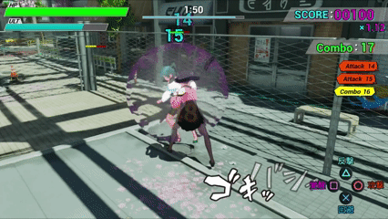

# 地雷系女子、復讐します — プレイヤー戦闘システム

## 概要

『地雷系女子、復讐します』は、彼氏に浮気された地雷系女子が、浮気相手と彼氏に復讐する3Dアクションゲームです。

本リポジトリでは、本作の開発で担当したプレイヤー戦闘システムのC++ソースコードを公開しています。

## ゲームプレイ

## 開発環境

* Unreal Engine 5
* C++
* Visual Studio

## 担当範囲

企画・プレイヤーの操作および戦闘に関するプログラムを担当しました。

* プレイヤーの移動
* 攻撃処理
* 回避処理
* カウンター処理
* 入力バッファ
* ターゲティング
* 戦闘に関連するアニメーション通知
* カメラシェイクなどの戦闘演出

## 技術的な工夫

### 戦闘システムのコンポーネント化

戦闘に関する機能をコンポーネント単位に分割し、それぞれの役割を明確にすることで、機能の追加や変更を行いやすい構成を意識しました。

### 入力バッファによる操作性の向上

アニメーションの特定区間で入力を受け付け、攻撃などの操作が適切なタイミングで処理される仕組みを実装しました。

### ターゲティングによる戦闘操作の支援

戦闘中に敵をターゲットとして選択し、攻撃対象を定めやすくするターゲティング機能を実装しました。敵との戦闘において、プレイヤーが狙った対象に攻撃を行いやすい操作性を意識しました。

## 公開範囲

本リポジトリは、開発時に担当したC++ソースコードを確認するためのものです。

ゲーム全体のプロジェクトデータ、アセット、設定ファイルなどは含まれていません。

## 作品情報

* **作品名：** 地雷系女子、復讐します
* **ジャンル：** 3Dアクションゲーム
* **開発形態：** チーム制作
* **担当：** 企画、プレイヤープログラム、SNSプロモーション
* **開発環境：** Unreal Engine 5 / C++
